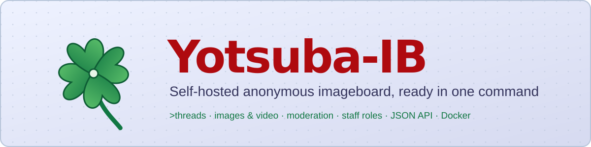

<p align="center">
  
</p>

<p align="center">
  <a href="https://github.com/niruxx/Yotsuba-IB/actions/workflows/ci.yml"></a>
  
  
  
  
</p>

<p align="center">
  <b>A self-hosted anonymous imageboard you can run with one command.</b><br>
  Boards, threads, image and video uploads, a full moderation suite and staff roles. Data is stored in SQLite and private per-board directories.
</p>

<p align="center">
  <a href="#-quick-start">Quick start</a> ·
  <a href="#-install-update--uninstall-linux-service">Install</a> ·
  <a href="#-features">Features</a> ·
  <a href="#-screenshots">Screenshots</a> ·
  <a href="#%EF%B8%8F-administration">Administration</a> ·
  <a href="#-operations">Operations</a> ·
  <a href="ROADMAP.md">Roadmap</a>
</p>

---

## 📸 Screenshots

> Screenshots live in [`docs/screenshots/`](docs/screenshots/). See the list there if you want to add or refresh them.

| Home (4chan-style Legacy layout) | Home (8kun-style Standard layout) |
|---|---|
|  |  |
| **Board index** | **Thread with quick reply** |
|  |  |
| **Catalog** | **User settings** |
|  |  |
| **Live moderation alerts** | **Homepage editor** |
|  |  |

---

## ✨ Features

<table>
<tr><td valign="top" width="50%">

### 🗨️ Posting
- Threads and replies, `>greentext`, `>>123` quotes and `>>>/board/123` cross-board links
- 📎 Uploads: **jpg, png, gif, webp, mp4, webm**, with file types checked by content
- 🖼️ Thumbnails for images *and* videos
- 🕵️ **EXIF/GPS and video metadata stripped** automatically
- 🔑 Tripcodes (`Name#pass`) and secure tripcodes (`Name##pass`)
- `sage` / `nonoko` options, spoiler images, `[spoiler]` and `[code]` tags
- 🗑️ Posters can delete their own posts with a deletion password
- 🏳️ Optional per-thread poster IDs and country flags

</td><td valign="top">

### 🧭 Browsing
- 🗂️ Board index, **catalog**, read-only **archive**, **search** and **RSS**
- 🔄 Thread auto-updater, unread counter and last-read marker
- 💬 Quick-reply box, hover previews, inline quotes, backlinks and **(You)** markers
- 👀 Thread watcher with unread counts
- 🙈 Post hiding and filters (text, regex, name, tripcode, ID)
- 🎨 Themes: **Yotsuba**, **Yotsuba B** and **Tomorrow** (dark)
- ⌨️ Keyboard shortcuts and a mobile-friendly layout
- ⚙️ A 4chan-style settings panel with six tabs, all saved in the browser

</td></tr>
<tr><td valign="top">

### 🛡️ Moderation
- 🚨 **Live keyword alerts** with on-screen pop-ups and desktop notifications
- 🚫 Bans by **IP**, **IP range** or **country**, blocking either posting or the whole site
- 🧬 File bans by SHA-256 and **perceptual hash**, which catch re-encoded copies
- 📣 User reports and **ban appeals**
- 📌 Sticky, lock, move and archive threads; delete just a file
- 🤖 Spam controls: cooldowns, link limits, duplicate-text rejection, flood limits
- 🔐 CSRF protection and limits on login attempts

</td><td valign="top">

### 👑 Administration
- **Owner** account created on first run
- **Staff** accounts with permissions granted one at a time, optionally limited to certain boards ("janitors")
- 📜 **Post logs**: IP, user agent, content and uploads, switchable on/off
- 🕵️ **Staff activity log**: the owner sees everything other staff do
- 🏠 **Homepage editor**: 4chan or 8kun presets, reorderable sections, renamable interface text, logo
- 🗓️ Retention settings for inactive threads, uploads and logs
- 🎉 Birthday hats on a date of your choosing

</td></tr>
</table>

---

## 📋 Requirements

| | Required | Notes |
|---|---|---|
| 🟢 **Node.js** | **22.13+** | Uses the built-in `node:sqlite`, so there's no database server to install |
| 🐧 **OS** | Linux, macOS or Windows | `install.sh` supports Arch, Debian/Ubuntu, Fedora/RHEL/Rocky/Alma and openSUSE with systemd |
| 🖼️ **sharp** | optional, installed automatically | Image thumbnails, metadata stripping and similar-image bans |
| 🎞️ **ffmpeg** | optional | Video thumbnails and video metadata stripping (`install.sh` installs it) |
| 🌍 **GeoIP DB** | optional | Needed for country bans and flags: `yotsuba-ib update-geoip` (free [DB-IP](https://db-ip.com) Lite, CC BY 4.0) |
| 💾 **Disk** | ~100 MB plus uploads | |

Without sharp or ffmpeg everything still works. Files are just stored as uploaded and shown without thumbnails.

---

## 🚀 Quick start

```bash
git clone https://github.com/niruxx/Yotsuba-IB.git
cd Yotsuba-IB
npm install
npm start
```

1. On first run you'll be asked to create the **owner** account.
2. Open **http://localhost:8420/admin** and log in.
3. Go to **Boards** and create your first board, e.g. `/b/`.
4. Visit **http://localhost:8420** 🎉

> 💡 For setups without a terminal to answer prompts, set the owner account with environment variables instead:
> `YOTSUBA_ADMIN_USER=owner YOTSUBA_ADMIN_PASS='a-long-password' npm start`

---

## 🐧 Install, update & uninstall (Linux service)

The scripts set Yotsuba-IB up as a **systemd service** with its own system user, restricted file access, and the data kept separate from the code.

### 📥 Install

```bash
git clone https://github.com/niruxx/Yotsuba-IB.git
cd Yotsuba-IB
sudo ./install.sh
```

The installer:

1. 🔍 **Detects your distro** (Arch, Debian/Ubuntu, Fedora/RHEL, openSUSE)
2. 📦 Installs **git, curl, ffmpeg and Node.js 22+**, adding the NodeSource repository if your distro's Node is too old
3. ❓ Asks for the **port** (default `8420`), address to listen on, site name, whether it runs behind a reverse proxy, and the upload limit
4. 👤 Creates the `yotsuba` system user, clones the code and installs packages
5. 🌍 Downloads the GeoIP country database
6. 👑 Asks you to create the **owner** account
7. ⚙️ Creates and starts `yotsuba-ib.service`, and offers to open the port in firewalld or ufw

| What | Where |
|---|---|
| 📁 Code (git clone) | `/opt/yotsuba-ib` |
| ⚙️ Config | `/opt/yotsuba-ib/config/yotsuba.env` |
| 💾 Database, uploads, backups | `/opt/yotsuba-ib-data` |
| 📜 Logs | `journalctl -u yotsuba-ib -f` |

### 🔄 Update

```bash
sudo ./update.sh
```

Backs up the database (keeping the last 10 backups), pulls the latest code, reinstalls packages, refreshes the GeoIP database and restarts the service.
**Your database, uploads, logs and config are never touched.**

### 🗑️ Uninstall

```bash
sudo ./uninstall.sh
```

> ⚠️ **Permanently deletes everything:** the service, code, database, all uploads, logs, backups, config, the `yotsuba` user and its journal logs. You must type `delete everything` to confirm. It also offers to delete the folder you ran it from. Node.js, git and ffmpeg are left installed.

---

## 🐳 Docker

```bash
# 1. Edit YOTSUBA_ADMIN_USER / YOTSUBA_ADMIN_PASS in docker-compose.yml
# 2. Start it
docker compose up -d
# 3. Optional: enable country bans and flags
docker compose exec yotsuba node bin/cli.js update-geoip && docker compose restart
```

Data is kept in the `yotsuba-data` volume. The image includes ffmpeg and a health check.

---

## 🛠️ Command line

```
yotsuba-ib [command] [options]

Commands
  (none)                 Start the server (asks for an owner account on first run)
  add-admin              Create a staff account (grant its permissions in Admin → Accounts)
  reset-password <user>  Set a new password for an account (e.g. a locked-out owner)
  update-geoip           Download/refresh the country database
  backup [file.tar.gz]   Full backup: database + uploads + banners (safe while running)
  restore <file>         Restore a backup (stop the server first; current data is moved aside)

Options
  -p, --port <n>         Port (default 8420, env PORT)
      --host <addr>      Bind address (default 0.0.0.0, env HOST)
  -d, --data <dir>       Data directory (default ./yotsuba-data, env YOTSUBA_DATA)
      --name <text>      Site name (env YOTSUBA_NAME)
      --max-file-mb <n>  Upload limit in MB (default 20)
      --trust-proxy      Use X-Forwarded-For (enable behind nginx/Caddy/Cloudflare)
```

> 💡 On systemd installs, run commands as the service user:
> `sudo -u yotsuba node /opt/yotsuba-ib/bin/cli.js backup --data /opt/yotsuba-ib-data`

---

## 🛡️ Administration

### 👥 Roles & permissions

The **owner** (the first account) can do everything:

- create staff accounts and grant permissions one at a time
- rename accounts and reset their passwords
- disable accounts, with a reason
- view the staff activity log

Staff start with **no permissions**:

| Permission | Allows |
|---|---|
| `delete_posts` | 🗑️ Delete posts and files; sticky, lock and move threads |
| `view_logs` | 📜 View post logs, including IP addresses |
| `manage_boards` | 🗂️ Create, edit and delete boards; banners and per-board rules |
| `manage_settings` | ⚙️ Site settings, retention, spam limits and the homepage editor |
| `view_alerts` | 🚨 Live keyword alerts, reports and appeals |
| `manage_filters` | 🔤 Keyword alert and block rules |
| `manage_bans` | 🚫 IP, range, country and file bans; handle appeals |

**Limit to boards** (on the Accounts page) restricts a staff member to specific boards, which turns them into a board janitor.

### 🧰 Admin pages

| Page | What it's for |
|---|---|
| 🏠 **Homepage** | Layout presets (4chan **Legacy** / 8kun **Standard**), section order and titles, custom text blocks, logo, and renaming interface text |
| 🗂️ **Boards** | Slug, title, bio, category, order, visibility, rules, banners, cooldowns, NSFW, allowed file types, text-only, required subject, forced anonymity, bump and image limits |
| 🚨 **Alerts** | Keyword matches, blocked posts, reports and appeals, updating live |
| 🔤 **Keyword rules** | Words, sentences or regexes that either *alert* or *block* |
| 🚫 **Bans** | IP, CIDR range or country ban; posting-only or full site; 1 hour to permanent; appeals and banned files |
| 📜 **Post logs** | IP, user agent, content and upload of every post, filterable by IP, board or type |
| ⚙️ **Settings** | Logging on/off, retention, archive length, cooldowns, spam limits, announcement, FAQ, backups, birthday hats, GeoIP header |
| 👥 **Accounts** / 🕵️ **Staff activity** | Owner only |

### 🗄️ Upload storage

Boards have private directories under the data directory. Existing uploads migrate automatically at startup; public media URLs remain unchanged.

```
boards/g/threads/123/123.json              # thread post
boards/g/threads/123/124.json              # reply
boards/g/threads/123/124.png               # uploaded image
boards/g/threads/123/124.json.log.out      # uploader name and IP
boards/g/threads/123/124.png.log.out       # matching upload log
```

These directories are never served directly. Media is served by post ID through `/media/`.

In **Admin > Settings**, post logging controls both database logs and `.log.out` files. Disabling it requires acknowledging that new posts will have no uploader oversight. Existing evidence is retained until log retention expires. Choose a private **log directory** (absolute or relative to the data directory) to store new logs elsewhere, and select **Move existing logs** to relocate current sidecars with their board/thread structure. External logs need separate backups; full backups include `boards`, while automatic snapshots include only SQLite. Logs left in previous locations without moving them must be managed separately.

In **Admin > Boards**, the owner can apply **4chan-style** or **8kun-style** curated starter templates. Merge adds missing boards while preserving the current homepage, board settings and posts. Replacement requires typing `REPLACE`, removes all existing boards and posts, resets site settings and applies the corresponding homepage design. Accounts, bans, server secret and moderation evidence remain. Each style also has an optional **adult boards (18+)** preset. All boards it creates are marked NSFW and show the entry warning. Merge the starter and adult presets to include both sets, or replace with an adult preset to create an adult-only site. Existing boards keep their settings during a merge. Templates are local starter sets, not live imports or exhaustive copies of those sites.

---

## 📈 Operations

| | |
|---|---|
| 💾 **Backups** | Automatic database snapshots (interval and number kept are set in Settings); `yotsuba-ib backup` / `restore` for full backups |
| ❤️ **Health** | `GET /healthz` returns JSON status |
| 📊 **Metrics** | `GET /metrics` in Prometheus format. Only answers localhost unless `YOTSUBA_METRICS_TOKEN` is set; then send `Authorization: Bearer <token>` |
| 🔌 **JSON API** | Read-only, CORS enabled, hidden boards excluded, no IPs: `/api/boards.json`, `/api/<board>/catalog.json`, `/api/<board>/threads/<id>.json`, `/api/<board>/archive.json` |
| 🧪 **Tests** | `npm test`: unit tests plus end-to-end tests against a temporary server; also run by GitHub Actions CI |

---

## 🏭 Production checklist

- [ ] 🔒 Run it behind a reverse proxy with **HTTPS** (Caddy is the easiest) and pass `--trust-proxy`
- [ ] 💾 Back up the data directory, or schedule `yotsuba-ib backup`
- [ ] ⚖️ Post logging stores **raw IP addresses**. Check the privacy laws that apply to you (e.g. GDPR) and set a log retention period
- [ ] 🌍 If you use country bans or flags, credit **DB-IP** on your site (CC BY 4.0 licence requirement)
- [ ] 🧹 Set up keyword rules and spam limits **before** going public
- [ ] 👮 You are responsible for moderating what users upload to your site

---

## 🗺️ Roadmap

See [**ROADMAP.md**](ROADMAP.md) for what's done and what's next. The main open items include S3 storage, audio/PDF uploads, off-site backup targets and video similarity detection.

## 🤝 Contributing

Issues and pull requests are welcome. Please run `npm test` before opening a PR.

## 📄 License

MIT

Boards can be marked **SFW** or **NSFW** under **Admin → Boards**, when creating or editing a board. NSFW board pages display a confirmation warning before showing content, including direct thread and catalog links. Confirmation is remembered separately for each board for the browser session. Customize the warning title and message under **Admin → Settings → NSFW board warning**.

Dependency audits, patching and deployment guidance: [Security maintenance](SECURITY.md).


### Posting security, attachments and language controls

- **CAPTCHA:** Enable image CAPTCHA in **Admin > Settings**. It applies to anonymous posting; logged-in staff are exempt. The self-hosted challenge requires `sharp`, expires after five minutes, is bound to the requesting client and can be used once. Refresh it in the posting form. This basic challenge complements the existing cooldowns and spam filters; it is not a guarantee against sophisticated bots. CAPTCHA challenges reset when the server restarts.
- **Staff two-factor authentication:** In **Admin > My account**, enter your password to start setup, add the displayed key to an authenticator app, then confirm its six-digit code within ten minutes. Save the eight single-use recovery codes shown after enrollment. Login then requires a fresh authenticator code or recovery code. Enrollment codes cannot immediately be reused to log in. Disabling 2FA requires the current password and a valid second factor. Enabling or disabling it revokes other signed-in sessions.
- **Board-specific bans:** In **Admin > Bans**, select one board or the entire site. Posting-only bans leave reading available; access bans cover the selected board, its API and media. Board-scoped staff can only manage bans for assigned boards, while unrestricted staff can also manage site-wide bans. Appeals retain the applicable board scope. File-hash bans remain site-wide and require unrestricted staff.
- **Multiple attachments:** Select up to four files in a posting form. The site maximum (one to four) is configurable in Settings. Each file receives independent content-type, size and file-ban checks; the entire submission is rejected when any file fails validation. The board's image limit counts all attachments, including those on the opening post. Deleting files removes all attachments on that post. Thread moves, retention, backups and private uploader logs include additional attachments. The JSON API retains legacy primary-file fields and adds an `attachments` array for additional files.
- **Bottom bar and languages:** All rendered pages share board navigation, a theme selector and a language selector. Themes persist in browser preferences and stay synchronized with the settings panel. Language selection is stored in a cookie and works without JavaScript. Core navigation, posting and account controls support English, Spanish, French, German, Portuguese, Japanese, Russian and Simplified Chinese. Untranslated administrative help and advanced settings use English; board names, rules and posts stay as authored.

NSFW board entry uses an accessible, mobile-friendly 18+ warning modal. Visitors must explicitly confirm they are 18 or older before continuing; declining or pressing Escape returns to the homepage. Confirmation is remembered per board for the browser session. The warning also appears on direct thread, catalog and archive links and works without JavaScript. This is a self-declared age warning, not identity or age verification. Customize its heading and additional message in Admin > Settings.


### Site appearance and default themes

Open **Admin > Appearance** to choose the default theme and customize the site's look. The seven built-in themes are Yotsuba, Yotsuba B, Tomorrow, Midnight, Sakura, Forest and Ocean. Midnight and Forest are dark palettes; Sakura and Ocean offer softer light palettes.

The appearance editor includes theme cards and a live preview of colors, spacing and typography. Configure board and homepage widths, side/panel/reply padding, reply spacing, rounded corners, base font size, line height, font family and catalog tile size. Page widths apply on the public pages after saving, and narrow screens adapt automatically. Enable **Custom site colors** to edit sixteen colors, including backgrounds, text, links, form controls, names and quotes. **Use selected theme colors** fills the pickers with the selected palette. Changes stay in the preview until **Save appearance** is clicked.

New visitors follow **Site default**, which is rendered before JavaScript runs. Visitors can choose any built-in theme using the bottom bar or Settings; their explicit choice is remembered in their browser. Choosing **Site default** again follows the administrator's current default and custom colors. Site-wide layout settings apply with every theme. Existing saved theme choices are preserved.

Appearance requires unrestricted `manage_settings` permission (or the owner account). All values are validated; no arbitrary CSS or scripts can be submitted through this panel. **Restore appearance defaults** resets only appearance, keeping homepage sections, text, boards and other settings. Homepage content and section arrangement remain under **Admin > Homepage**.


### Drawing, users, donors and independent boards

**Drawing / oekaki:** On boards that accept PNG uploads, choose **Draw an image** in the posting form. The 640?480 canvas supports mouse, pen and touch, brush colors and sizes, an eraser, undo/redo and clearing. **Attach drawing to post** exports a PNG into the file picker while preserving already selected files. Submit the post normally when ready. Drawings receive the same type checks, file bans, limits, thumbnails, metadata handling and uploader logs as other uploads. **Download PNG** saves a local copy, including as a fallback for browsers without direct attachment support. Drawing tools also work in quick reply; artwork stays in browser memory until attached or downloaded.

**Accounts:** The site owner can use **Admin > Accounts** to create users, board-owner accounts, moderators and staff; edit display names, reset passwords, disable accounts and assign global permissions and board scopes. The `board_owner` account label alone does not grant board access: ownership and moderator permissions are assigned on individual board team pages. Ordinary accounts remain subject to CAPTCHA, spam limits and bans. All accounts can use the existing authenticator-based 2FA and recovery codes.

**Donors:** Donor status and a custom donor badge label are manually controlled by the site owner, separately from account role and moderation powers. A signed-in user can choose **Post as [display name]** on each post to show their account indicator and donor badge. Anonymous posting remains available, and forced-anonymous boards suppress account identity and donor badges. This feature manages donor recognition; it does not process payments.

**Independent boards:** Enable registered-user board creation in **Admin > Settings > Community accounts**, or grant **Create and own boards** to specific accounts. Public account registration is separately optional and disabled by default; the site owner can always provision accounts. Users sign in and open **My boards** to create a board, subject to the configured owned-board limit. New board owners can edit their own title, description, rules, posting settings, visibility and banners, and select a board-specific built-in theme. Visitors' explicit theme choices remain respected.

**Ownership and moderator controls:** Open **Admin > Boards > Team and ownership** for a board. The site owner can assign or remove board owners and moderators and independently grant editing, board deletion, team management, post moderation, alerts, bans and raw-IP log access. Owners of self-created boards start with editing, deletion, team, post, alert and board-ban permissions; raw-IP logs require a separate site-owner grant. Team managers can add existing accounts or create ordinary accounts for their board and appoint moderators, but cannot appoint owners, alter site-wide roles/donor status, edit their own assignment or another board owner's assignment, or grant powers they do not hold. Non-site-owner team managers are limited to twenty team members per board. Revocations take effect on the next request, and live alert streams recheck current permissions.

Existing global staff permissions and legacy board scopes remain supported. Global appearance, homepage, settings, keyword rules, templates and account administration remain protected from independent board owners. A moderator can ban a poster without raw-IP log permission; the address is resolved server-side and hidden in the moderation interface.


### Formatting, external videos and board discovery

Posting forms now offer formatting buttons, also supported in quick reply:

- `[b]bold[/b]`, `[i]italic[/i]`, `[u]underline[/u]`, `[s]strikethrough[/s]`
- `[aa]ASCII art[/aa]` preserves spaces and line breaks without parsing formatting or quote links inside the block.
- `[code]code[/code]` and `[spoiler]spoiler[/spoiler]` remain supported. Formatting can nest; arbitrary HTML is always escaped.

Supported YouTube (watch, short, live and share URLs) and Vimeo links gain **Load video** buttons. Players load only after a visitor clicks, never automatically through thumbnails, metadata requests or preloaded iframes. The button warns that loading shares the visitor's connection IP with the provider. Players use YouTube's privacy-enhanced hostname or Vimeo's `dnt` option, with no forced autoplay; **Unload video** removes the player. Links inside code, ASCII-art and spoiler blocks do not produce players. Up to three distinct videos are offered per post. Provider-side privacy or embedding restrictions may still prevent playback. The site setting is under **Admin > Discovery / Webring**, with an additional per-board switch under **Boards**.

Open **Boards & trends** (`/boards`) for the searchable public board directory and trending rankings. Use each board's **Favorite** button for personalized navigation in both bars. Guests save favorites in their browser; signed-in users sync up to 100 favorites to their account. Guest and account lists remain separate. Private boards are excluded from the public directory and trending endpoint, and account favorites only return boards the current user can access.

Trending ranks currently retained posts and new threads in the last 24 hours relative to the previous 24 hours. SFW-only ranking is the default. Administrators can disable trending or include adult-board metadata under **Discovery / Webring**. Read-only rankings are available at `/api/trending.json`.

### Webring participation

In **Admin > Discovery / Webring**, enable the webring, supply the site's public URL and enter an approved list of communities as JSON. Each member supports `name`, `url`, optional `endpoint`, `description` and boolean `nsfw`. HTTP(S) destinations, including onion service URLs, are accepted; onion links require a Tor-capable browser.

The directory at `/webring` provides community links and previous/next/random navigation around this site's approved list. `/webring.json` exports this site's name, configured URL, endpoint, `following`, `known` peers and public board metadata. Hidden boards are never exported. This implementation uses curated membership: it does not crawl remote feeds, fetch logos, recursively discover peers or import their content. There are no background requests to participating communities.

### DNS blocklists and Tor controls

**Admin > Network controls** is restricted to unrestricted site-settings administrators. DNSBL checks are off by default, with no provider selected. Configure up to five zones with the provider's documented positive return codes, one per line, for example `dnsbl.example.org=127.0.0.2,127.0.0.3`. Use a provider and DNS resolver authorized for your deployment. Queries use reversed IPv4 octets or expanded/reversed IPv6 nibbles. Only configured positive codes block posting; provider error codes are not treated as spam listings. Results are cached for five minutes, lookups have bounded resolver timeouts and concurrency, and local/private addresses are skipped. Configure whether lookup failures allow posting (default) or return a temporary rejection. Moderator exemptions apply only on boards they moderate. DNSBL queries disclose the connecting IP to the resolver/provider. These checks complement the existing posting limits and filters.

Tor exit detection uses a locally cached official Tor Project exit list, refreshed with **Refresh official Tor exit list**. Refresh it regularly: lists older than seven days are ignored. Additional known exit/proxy IPs can be configured manually. Neither arbitrary Tor headers nor onion-looking Host headers mark a request as Tor traffic. The default skips DNSBL checks for detected Tor exits to avoid blocking shared exits; administrators can opt in.

The site-wide Tor posting policy is **allow**, **captcha** or **block** (default: allow). Boards can strengthen that policy but cannot weaken it. CAPTCHA policies require sharp. Detected Tor clients use a signed, HttpOnly session cookie for client cooldowns (30 seconds by default), alongside a separate shared-exit cooldown (3 seconds) and board flood controls. Resetting a cookie does not bypass the exit cooldown. Tor session identifiers expire after 24 hours and are not stored in post logs. Country flags are suppressed for detected Tor posts, and moderator views flag shared Tor networks before an IP ban. Logging, when enabled, records the observed exit or gateway IP, not the user's original IP.

For an onion service, run a dedicated listener bound to loopback, e.g. `node bin/cli.js --data ./yotsuba-data --host 127.0.0.1 --port 8421 --tor-listener`, and point the onion service at that port. `YOTSUBA_TOR_LISTENER=1` enables the same mode. The CLI refuses a non-loopback host with this flag. It marks all requests on that listener as Tor traffic; do not enable it on a general clearnet listener. Correct reverse-proxy trust and restricted backend access remain essential when using forwarded client IPs.

Network settings and webring configuration live in SQLite. Full backups also include the cached Tor exit list under `network/`; database-only snapshots do not include it. Useful upstream references: [DNSBL query/return-code documentation](https://docs.spamhaus.com/datasets/docs/source/70-access-methods/data-query-service/040-dqs-queries.html), [Tor exit-list sources](https://rhatto.pages.torproject.net/wikipelago/network-health/metrics/exit-list-check/), [YouTube player documentation](https://developers.google.com/youtube/player_parameters) and [Vimeo embed options](https://developer.vimeo.com/player/sdk/embed).
