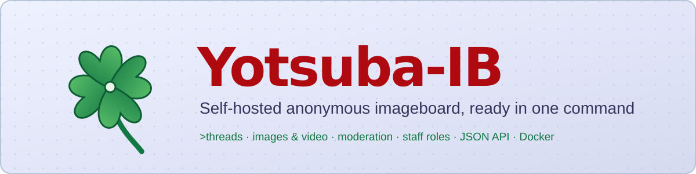

<p align="center">
  
</p>

<p align="center">
  <a href="https://github.com/niruxx/Yotsuba-IB/actions/workflows/ci.yml"></a>
  
  
  
  
</p>

<p align="center">
  <b>A self-hosted anonymous imageboard you can run with one command.</b><br>
  Boards, threads, image and video uploads, a full moderation suite and staff roles. Everything is stored in one SQLite file and an uploads folder.
</p>

<p align="center">
  <a href="#-quick-start">Quick start</a> ·
  <a href="#-install-update--uninstall-linux-service">Install</a> ·
  <a href="#-features">Features</a> ·
  <a href="#-screenshots">Screenshots</a> ·
  <a href="#%EF%B8%8F-administration">Administration</a> ·
  <a href="#-operations">Operations</a> ·
  <a href="ROADMAP.md">Roadmap</a>
</p>

---

## 📸 Screenshots

> Screenshots live in [`docs/screenshots/`](docs/screenshots/). See the list there if you want to add or refresh them.

| Home (4chan-style Legacy layout) | Home (8kun-style Standard layout) |
|---|---|
|  |  |
| **Board index** | **Thread with quick reply** |
|  |  |
| **Catalog** | **User settings** |
|  |  |
| **Live moderation alerts** | **Homepage editor** |
|  |  |

---

## ✨ Features

<table>
<tr><td valign="top" width="50%">

### 🗨️ Posting
- Threads and replies, `>greentext`, `>>123` quotes and `>>>/board/123` cross-board links
- 📎 Uploads: **jpg, png, gif, webp, mp4, webm**, with file types checked by content
- 🖼️ Thumbnails for images *and* videos
- 🕵️ **EXIF/GPS and video metadata stripped** automatically
- 🔑 Tripcodes (`Name#pass`) and secure tripcodes (`Name##pass`)
- `sage` / `nonoko` options, spoiler images, `[spoiler]` and `[code]` tags
- 🗑️ Posters can delete their own posts with a deletion password
- 🏳️ Optional per-thread poster IDs and country flags

</td><td valign="top">

### 🧭 Browsing
- 🗂️ Board index, **catalog**, read-only **archive**, **search** and **RSS**
- 🔄 Thread auto-updater, unread counter and last-read marker
- 💬 Quick-reply box, hover previews, inline quotes, backlinks and **(You)** markers
- 👀 Thread watcher with unread counts
- 🙈 Post hiding and filters (text, regex, name, tripcode, ID)
- 🎨 Themes: **Yotsuba**, **Yotsuba B** and **Tomorrow** (dark)
- ⌨️ Keyboard shortcuts and a mobile-friendly layout
- ⚙️ A 4chan-style settings panel with six tabs, all saved in the browser

</td></tr>
<tr><td valign="top">

### 🛡️ Moderation
- 🚨 **Live keyword alerts** with on-screen pop-ups and desktop notifications
- 🚫 Bans by **IP**, **IP range** or **country**, blocking either posting or the whole site
- 🧬 File bans by SHA-256 and **perceptual hash**, which catch re-encoded copies
- 📣 User reports and **ban appeals**
- 📌 Sticky, lock, move and archive threads; delete just a file
- 🤖 Spam controls: cooldowns, link limits, duplicate-text rejection, flood limits
- 🔐 CSRF protection and limits on login attempts

</td><td valign="top">

### 👑 Administration
- **Owner** account created on first run
- **Staff** accounts with permissions granted one at a time, optionally limited to certain boards ("janitors")
- 📜 **Post logs**: IP, user agent, content and uploads, switchable on/off
- 🕵️ **Staff activity log**: the owner sees everything other staff do
- 🏠 **Homepage editor**: 4chan or 8kun presets, reorderable sections, renamable interface text, logo
- 🗓️ Retention settings for inactive threads, uploads and logs
- 🎉 Birthday hats on a date of your choosing

</td></tr>
</table>

---

## 📋 Requirements

| | Required | Notes |
|---|---|---|
| 🟢 **Node.js** | **22.13+** | Uses the built-in `node:sqlite`, so there's no database server to install |
| 🐧 **OS** | Linux, macOS or Windows | `install.sh` supports Arch, Debian/Ubuntu, Fedora/RHEL/Rocky/Alma and openSUSE with systemd |
| 🖼️ **sharp** | optional, installed automatically | Image thumbnails, metadata stripping and similar-image bans |
| 🎞️ **ffmpeg** | optional | Video thumbnails and video metadata stripping (`install.sh` installs it) |
| 🌍 **GeoIP DB** | optional | Needed for country bans and flags: `yotsuba-ib update-geoip` (free [DB-IP](https://db-ip.com) Lite, CC BY 4.0) |
| 💾 **Disk** | ~100 MB plus uploads | |

Without sharp or ffmpeg everything still works. Files are just stored as uploaded and shown without thumbnails.

---

## 🚀 Quick start

```bash
git clone https://github.com/niruxx/Yotsuba-IB.git
cd Yotsuba-IB
npm install
npm start
```

1. On first run you'll be asked to create the **owner** account.
2. Open **http://localhost:8420/admin** and log in.
3. Go to **Boards** and create your first board, e.g. `/b/`.
4. Visit **http://localhost:8420** 🎉

> 💡 For setups without a terminal to answer prompts, set the owner account with environment variables instead:
> `YOTSUBA_ADMIN_USER=owner YOTSUBA_ADMIN_PASS='a-long-password' npm start`

---

## 🐧 Install, update & uninstall (Linux service)

The scripts set Yotsuba-IB up as a **systemd service** with its own system user, restricted file access, and the data kept separate from the code.

### 📥 Install

```bash
git clone https://github.com/niruxx/Yotsuba-IB.git
cd Yotsuba-IB
sudo ./install.sh
```

The installer:

1. 🔍 **Detects your distro** (Arch, Debian/Ubuntu, Fedora/RHEL, openSUSE)
2. 📦 Installs **git, curl, ffmpeg and Node.js 22+**, adding the NodeSource repository if your distro's Node is too old
3. ❓ Asks for the **port** (default `8420`), address to listen on, site name, whether it runs behind a reverse proxy, and the upload limit
4. 👤 Creates the `yotsuba` system user, clones the code and installs packages
5. 🌍 Downloads the GeoIP country database
6. 👑 Asks you to create the **owner** account
7. ⚙️ Creates and starts `yotsuba-ib.service`, and offers to open the port in firewalld or ufw

| What | Where |
|---|---|
| 📁 Code (git clone) | `/opt/yotsuba-ib` |
| ⚙️ Config | `/opt/yotsuba-ib/config/yotsuba.env` |
| 💾 Database, uploads, backups | `/opt/yotsuba-ib-data` |
| 📜 Logs | `journalctl -u yotsuba-ib -f` |

### 🔄 Update

```bash
sudo ./update.sh
```

Backs up the database (keeping the last 10 backups), pulls the latest code, reinstalls packages, refreshes the GeoIP database and restarts the service.
**Your database, uploads, logs and config are never touched.**

### 🗑️ Uninstall

```bash
sudo ./uninstall.sh
```

> ⚠️ **Permanently deletes everything:** the service, code, database, all uploads, logs, backups, config, the `yotsuba` user and its journal logs. You must type `delete everything` to confirm. It also offers to delete the folder you ran it from. Node.js, git and ffmpeg are left installed.

---

## 🐳 Docker

```bash
# 1. Edit YOTSUBA_ADMIN_USER / YOTSUBA_ADMIN_PASS in docker-compose.yml
# 2. Start it
docker compose up -d
# 3. Optional: enable country bans and flags
docker compose exec yotsuba node bin/cli.js update-geoip && docker compose restart
```

Data is kept in the `yotsuba-data` volume. The image includes ffmpeg and a health check.

---

## 🛠️ Command line

```
yotsuba-ib [command] [options]

Commands
  (none)                 Start the server (asks for an owner account on first run)
  add-admin              Create a staff account (grant its permissions in Admin → Accounts)
  reset-password <user>  Set a new password for an account (e.g. a locked-out owner)
  update-geoip           Download/refresh the country database
  backup [file.tar.gz]   Full backup: database + uploads + banners (safe while running)
  restore <file>         Restore a backup (stop the server first; current data is moved aside)

Options
  -p, --port <n>         Port (default 8420, env PORT)
      --host <addr>      Bind address (default 0.0.0.0, env HOST)
  -d, --data <dir>       Data directory (default ./yotsuba-data, env YOTSUBA_DATA)
      --name <text>      Site name (env YOTSUBA_NAME)
      --max-file-mb <n>  Upload limit in MB (default 20)
      --trust-proxy      Use X-Forwarded-For (enable behind nginx/Caddy/Cloudflare)
```

> 💡 On systemd installs, run commands as the service user:
> `sudo -u yotsuba node /opt/yotsuba-ib/bin/cli.js backup --data /opt/yotsuba-ib-data`

---

## 🛡️ Administration

### 👥 Roles & permissions

The **owner** (the first account) can do everything:

- create staff accounts and grant permissions one at a time
- rename accounts and reset their passwords
- disable accounts, with a reason
- view the staff activity log

Staff start with **no permissions**:

| Permission | Allows |
|---|---|
| `delete_posts` | 🗑️ Delete posts and files; sticky, lock and move threads |
| `view_logs` | 📜 View post logs, including IP addresses |
| `manage_boards` | 🗂️ Create, edit and delete boards; banners and per-board rules |
| `manage_settings` | ⚙️ Site settings, retention, spam limits and the homepage editor |
| `view_alerts` | 🚨 Live keyword alerts, reports and appeals |
| `manage_filters` | 🔤 Keyword alert and block rules |
| `manage_bans` | 🚫 IP, range, country and file bans; handle appeals |

**Limit to boards** (on the Accounts page) restricts a staff member to specific boards, which turns them into a board janitor.

### 🧰 Admin pages

| Page | What it's for |
|---|---|
| 🏠 **Homepage** | Layout presets (4chan **Legacy** / 8kun **Standard**), section order and titles, custom text blocks, logo, and renaming interface text |
| 🗂️ **Boards** | Slug, title, bio, category, order, visibility, rules, banners, cooldowns, NSFW, allowed file types, text-only, required subject, forced anonymity, bump and image limits |
| 🚨 **Alerts** | Keyword matches, blocked posts, reports and appeals, updating live |
| 🔤 **Keyword rules** | Words, sentences or regexes that either *alert* or *block* |
| 🚫 **Bans** | IP, CIDR range or country ban; posting-only or full site; 1 hour to permanent; appeals and banned files |
| 📜 **Post logs** | IP, user agent, content and upload of every post, filterable by IP, board or type |
| ⚙️ **Settings** | Logging on/off, retention, archive length, cooldowns, spam limits, announcement, FAQ, backups, birthday hats, GeoIP header |
| 👥 **Accounts** / 🕵️ **Staff activity** | Owner only |

### 🗄️ Upload storage

Files are stored per thread, so staff with server access can see who uploaded what:

```
uploads/threads/<threadId>-<subject>.<OP's IP>/post-image-<IP>.<ext>
uploads/threads/<threadId>-<subject>.<OP's IP>/<postId>.imagefile.<IP>.<ext>
```

🔒 This folder is **never served directly**. Visitors get files from `/media/<postId>.<ext>`, which never reveals the path. When post logging is off, `nolog` is written instead of the IP.

---

## 📈 Operations

| | |
|---|---|
| 💾 **Backups** | Automatic database snapshots (interval and number kept are set in Settings); `yotsuba-ib backup` / `restore` for full backups |
| ❤️ **Health** | `GET /healthz` returns JSON status |
| 📊 **Metrics** | `GET /metrics` in Prometheus format. Only answers localhost unless `YOTSUBA_METRICS_TOKEN` is set; then send `Authorization: Bearer <token>` |
| 🔌 **JSON API** | Read-only, CORS enabled, hidden boards excluded, no IPs: `/api/boards.json`, `/api/<board>/catalog.json`, `/api/<board>/threads/<id>.json`, `/api/<board>/archive.json` |
| 🧪 **Tests** | `npm test`: unit tests plus end-to-end tests against a temporary server; also run by GitHub Actions CI |

---

## 🏭 Production checklist

- [ ] 🔒 Run it behind a reverse proxy with **HTTPS** (Caddy is the easiest) and pass `--trust-proxy`
- [ ] 💾 Back up the data directory, or schedule `yotsuba-ib backup`
- [ ] ⚖️ Post logging stores **raw IP addresses**. Check the privacy laws that apply to you (e.g. GDPR) and set a log retention period
- [ ] 🌍 If you use country bans or flags, credit **DB-IP** on your site (CC BY 4.0 licence requirement)
- [ ] 🧹 Set up keyword rules and spam limits **before** going public
- [ ] 👮 You are responsible for moderating what users upload to your site

---

## 🗺️ Roadmap

See [**ROADMAP.md**](ROADMAP.md) for what's done and what's next. The main open items are captcha, two-factor login for staff, S3 storage and multiple files per post.

## 🤝 Contributing

Issues and pull requests are welcome. Please run `npm test` before opening a PR.

## 📄 License

MIT
